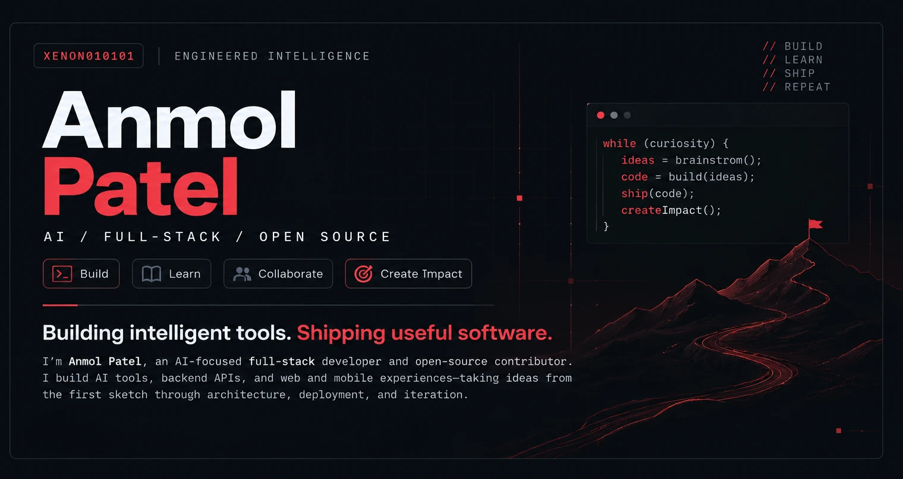
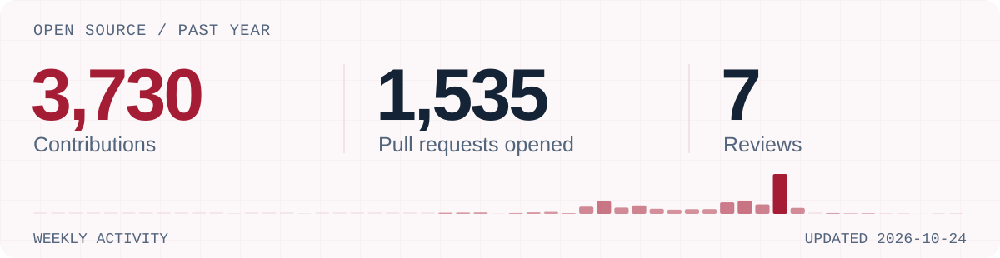

<picture>
  <source media="(prefers-color-scheme: dark) and (max-width: 600px)" srcset="assets/achievement-mobile-dark.svg">
  <source media="(max-width: 600px)" srcset="assets/achievement-mobile-light.svg">
  <source media="(prefers-color-scheme: dark)" srcset="assets/achievement-dark.svg">
  
</picture>
  

**GSSoC 2026 · Rank #5.** Open source is where I sharpen my craft: real codebases, thoughtful collaboration, useful contributions.

 

## Featured Project

### Chhath Puja Vibes

An interactive journey through the festival's **four days**, with immersive artwork and a custom music player. **[Visit the live website →](https://chhathpujavibes.online/)**

 

## Selected Builds

Some of the projects I have enjoyed building and improving.

- **InsiderEdge** — Autonomous AI for market analysis, decision support, and strategy exploration. _AI Automation · Market Analysis_ · [Live ↗](https://xenon010101.github.io/InsiderEdge/)
- **FocusTube** — A distraction-reduced video experience designed for intentional viewing. _Browser Experience · Product Development_ · [Source ↗](https://github.com/Xenon010101/FocusTube)
- **ArogyaAI** — An AI-powered assistant exploring accessible health information and intelligent support. _Healthcare AI · Applied AI_ · [Live ↗](https://arogyaai-demo.onrender.com/)
- **PresentAI** — An AI-powered presentation evaluator delivering structured, actionable feedback. _Applied AI · Presentation Feedback_ · [Source ↗](https://github.com/Xenon010101/PresentAI)

  <a href="https://github.com/Xenon010101?tab=repositories"><strong>Browse all repositories ↗</strong></a>

 

## Open-source activity

<!-- ACTIVITY:START -->

<picture>
  <source media="(prefers-color-scheme: dark) and (max-width: 600px)" srcset="assets/activity-mobile-dark.svg">
  <source media="(max-width: 600px)" srcset="assets/activity-mobile-light.svg">
  <source media="(prefers-color-scheme: dark)" srcset="assets/activity-dark.svg">
  
</picture>

GitHub's past-year window · 2025-10-26 to 2026-10-28 · <a href="assets/activity.json">Snapshot data</a>
<!-- ACTIVITY:END -->

 

## Technical toolkit

| Layer | Tools I work with |
| :--- | :--- |
| **Languages** | C · C++ · Python · JavaScript · Dart |
| **Applications** | React · Node.js · Express · Flutter |
| **Data** | MySQL · Firebase |
| **Infrastructure** | Git · Linux · Docker · CI/CD |

### Currently exploring

* **AI:** Practical AI agents & AI-powered applications
* **Backend:** Architecture & system design
* **Frontend:** Modern React
* **Mobile:** React Native
* **DevOps:** Docker, Linux & CI/CD

 

  
  &nbsp;
  

 

## Contribution Trail

<picture>
  <source
    media="(prefers-color-scheme: dark)"
    srcset="https://raw.githubusercontent.com/Xenon010101/Xenon010101/output/github-contribution-grid-snake-dark.svg"
  >
  
</picture>

